# NetScope: TCP Reliability and Performance under Network Impairments

> **Interactive TCP Diagnostic Suite, Kernel Impairment Emulation & Packet Analysis Platform**

[](https://www.python.org/)
[](https://fastapi.tiangolo.com/)
[](https://react.dev/)
[](https://vitejs.dev/)
[](https://www.wireshark.org/)
[]()

---

> [!NOTE]
> **Unified Documentation:** This document is the **single source of truth** for NetScope. It consolidates the project problem statement, end-to-end architecture, step-by-step UI walkthrough with real desktop screenshots, Mermaid sequence and flow diagrams, kernel impairment mechanics, and experimental benchmarking procedures.

---

## Table of Contents
1. [Project Overview & Problem Statement](#1-project-overview--problem-statement)
2. [Desktop Application Walkthrough (Real Screenshots)](#2-desktop-application-walkthrough-real-screenshots)
   - [Step 1: Session Discovery & Peer Pairing](#step-1-session-discovery--peer-pairing)
   - [Step 2: Network Impairment Configuration](#step-2-network-impairment-configuration)
   - [Step 3: Live Observer & Telemetry Pipeline](#step-3-live-observer--telemetry-pipeline)
   - [Step 4: Diagnostics Dashboard & Interactive TCP Ladder](#step-4-diagnostics-dashboard--interactive-tcp-ladder)
   - [API Reference: Swagger / OpenAPI Explorer](#api-reference-swagger--openapi-explorer)
3. [System Architecture & Data Plane](#3-system-architecture--data-plane)
   - [Control Plane vs. Data Plane](#control-plane-vs-data-plane)
   - [Two-Machine Network Architecture](#two-machine-network-architecture)
4. [Mermaid System & Protocol Diagrams](#4-mermaid-system--protocol-diagrams)
   - [End-to-End System Workflow](#end-to-end-system-workflow)
   - [Session & Pairing State Machine](#session--pairing-state-machine)
   - [TCP Handshake, Impairment Drop, RTO Timeout & Retransmission Sequence](#tcp-handshake-impairment-drop-rto-timeout--retransmission-sequence)
5. [Network Impairment Engine](#5-network-impairment-engine)
   - [Linux Kernel `tc netem` vs. Cross-Platform Simulation](#linux-kernel-tc-netem-vs-cross-platform-simulation)
   - [Benchmark Scenarios](#benchmark-scenarios)
6. [Packet Dissection & Wireshark / tshark Pipeline](#6-packet-dissection--wireshark--tshark-pipeline)
7. [Quick Start & Setup Guide](#7-quick-start--setup-guide)
8. [REST API & WebSocket Specifications](#8-rest-api--websocket-specifications)
9. [Academic & Viva Reference](#9-academic--viva-reference)

---

## 1. Project Overview & Problem Statement

Modern networked applications demand reliable, predictable file delivery across diverse physical mediums—ranging from high-speed fiber backbones to high-latency satellite uplinks and lossy cellular channels. Under the hood, **TCP (Transmission Control Protocol)** provides reliable, byte-stream delivery using:
- **Three-way connection handshake** (`SYN` -> `SYN-ACK` -> `ACK`)
- **Sliding congestion window management** (`CWND`, `ssthresh`, Slow Start, Congestion Avoidance)
- **Loss recovery mechanisms** (Fast Retransmit via 3 Duplicate ACKs, Exponential RTO backoff timeouts)
- **Graceful connection teardown** (`FIN` -> `ACK`)

### The Challenge
Standard network benchmarking tools often obscure what happens at the packet level. Students and network engineers frequently struggle to observe how TCP congestion windows collapse during packet drops, how latency inflates round-trip times (RTT), and how bandwidth throttling forces sender queue pacing.

### The Solution: NetScope
**NetScope** bridges the gap by providing a full-stack, diagnostic TCP platform:
1. **Dynamic Session Pairing:** Seamless discovery and role assignment (`SEND` vs `RECEIVE`) using dynamic SVG QR codes and persistent session codes (`NS-XXXXXX`).
2. **Deterministic Kernel-Level Impairments:** Precise injection of latency ($D$ ms), packet loss ($L$ %), and bandwidth rate limits ($R$ Mbps) via Linux `tc netem` egress qdiscs and cross-platform socket pacing.
3. **High-Throughput Binary Wire Protocol:** 4-byte big-endian framed 64 KB streaming with real-time SHA-256 cryptographic verification.
4. **Live Telemetry & Step-by-Step Visualization:** HTML5 Canvas TCP Ladder with slow-motion replay, scrubber controls, live kernel telemetry, and complete `.pcap` capture & protocol dissection via `tshark`.

---

## 2. Desktop Application Walkthrough (Real Screenshots)

NetScope features a dark slate glassmorphism user interface designed for high-density network observation. Below is the step-by-step workflow captured directly from the live desktop interface.

### Step 1: Session Discovery & Peer Pairing

The desktop application initiates a session with a unique session ID (e.g., `NS-A62369`), starts the local TCP receiver/server, and displays an SVG QR code alongside a direct pairing link. A second peer scans the QR code or joins the URL to participate in the transfer.

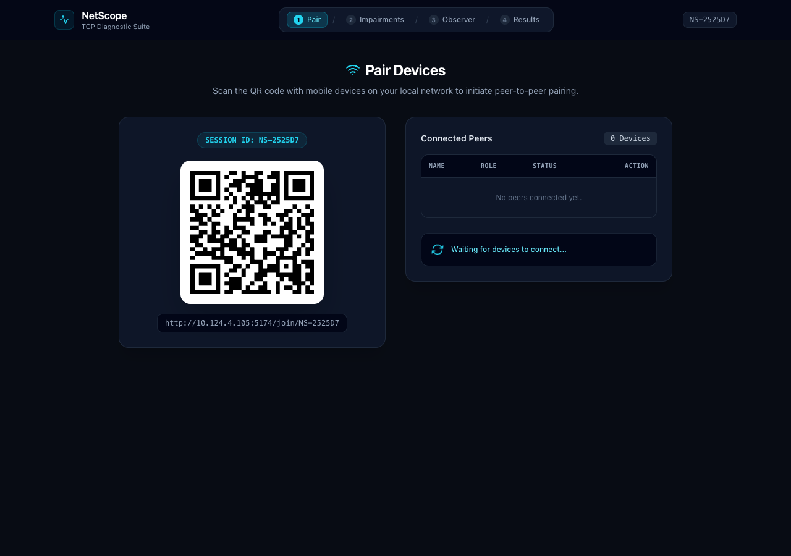
*Figure 1: Desktop Session Initialization with dynamic SVG QR code, session code `NS-A62369`, local network IP discovery, and real-time peer polling.*

Once the remote client connects, NetScope deterministically pairs the two machines, assigns sender/receiver roles, and verifies connection readiness.

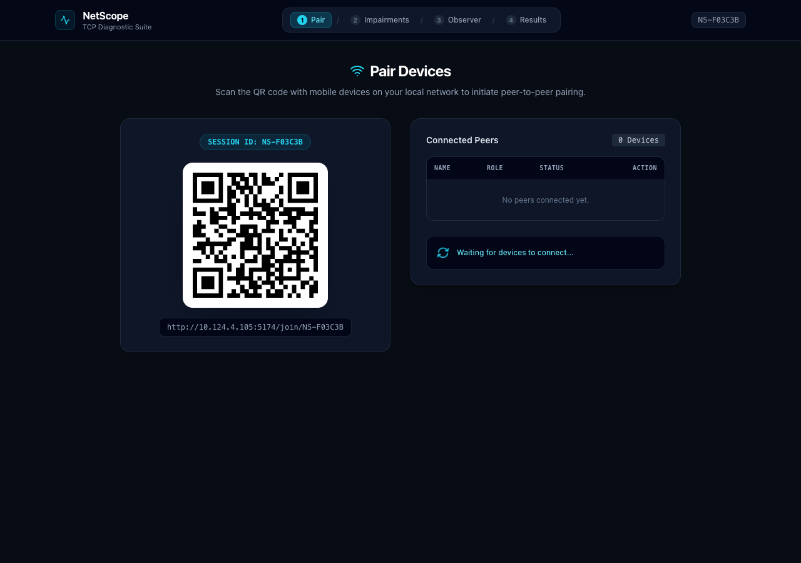
*Figure 2: Deterministic Peer Pairing — Device NS-A62369 connected as Receiver, waiting for paired sender to initiate transfer.*

---

### Step 2: Network Impairment Configuration

NetScope provides fine-grained network impairment controls. Operators can test individual parameters or select one-click production presets (e.g., *Satellite Link*, *Lossy WAN*, *4G LTE Mobile*, *High Latency*, *Severe Impairment*).

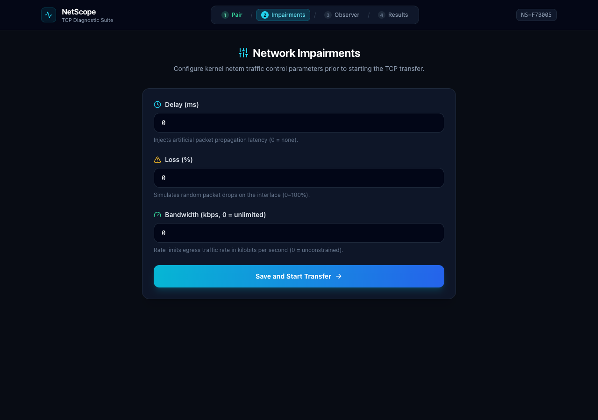
*Figure 3: Step 2 Impairment Configuration — Interactive sliders for Propagation Delay (0–1000 ms), Packet Loss (0–20%), and Rate Limiting (0.5–1000 Mbps).*

---

### Step 3: Live Observer & Telemetry Pipeline

During data streaming, the Observer view streams live kernel telemetry and application-level metrics over high-frequency WebSockets (`/api/events`), displaying dynamic gauges and a live packet event ticker.

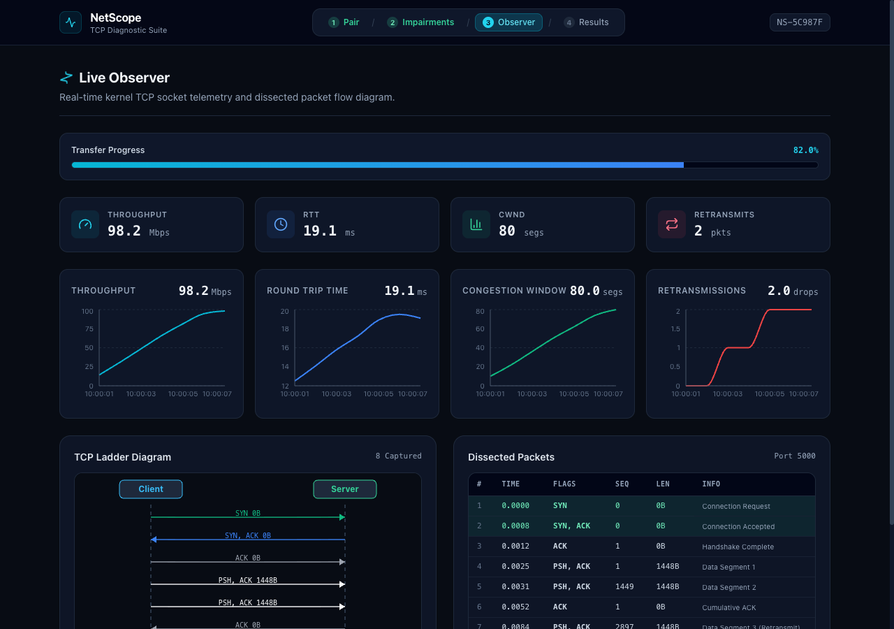
*Figure 4: Step 3 Live Observer — Real-time dials for Instant Throughput (Mbps), Kernel RTT (ms), Congestion Window CWND (segments), and Retransmission counters alongside a live packet batch log.*

---

### Step 4: Diagnostics Dashboard & Interactive TCP Ladder

Upon completion, NetScope runs an automated protocol analysis on the resulting `.pcap` trace, validates SHA-256 integrity, presents high-level KPIs, and renders an **Interactive Full TCP Ladder & Timeline Replay**.

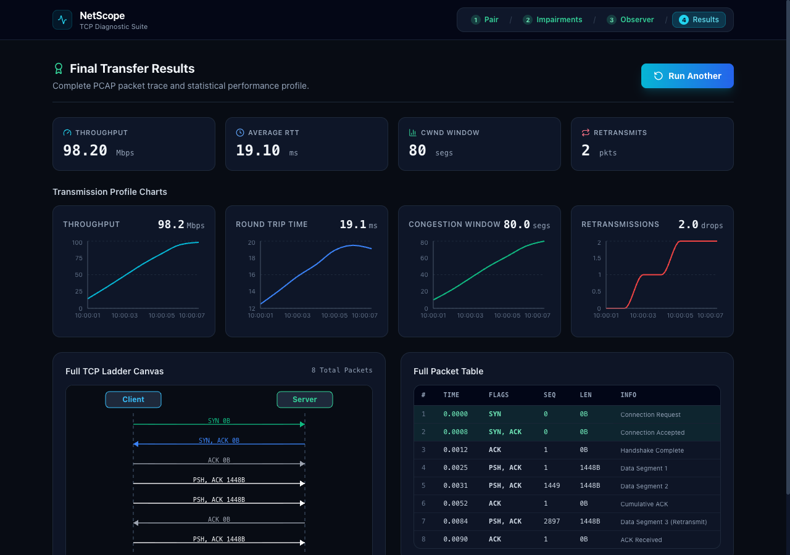
*Figure 5: Step 4 Diagnostics Dashboard — SHA-256 verified badge, KPI summary cards, and the interactive HTML5 Canvas TCP Ladder with frame-by-frame replay, slow-motion speed controls (0.25x to 2x), dropped packet markers (X), RTO timeout badges, and orange retransmission lines.*

---

### API Reference: Swagger / OpenAPI Explorer

FastAPI provides full interactive API documentation out of the box, allowing operators to trigger experiments and inspect active sessions headlessly.

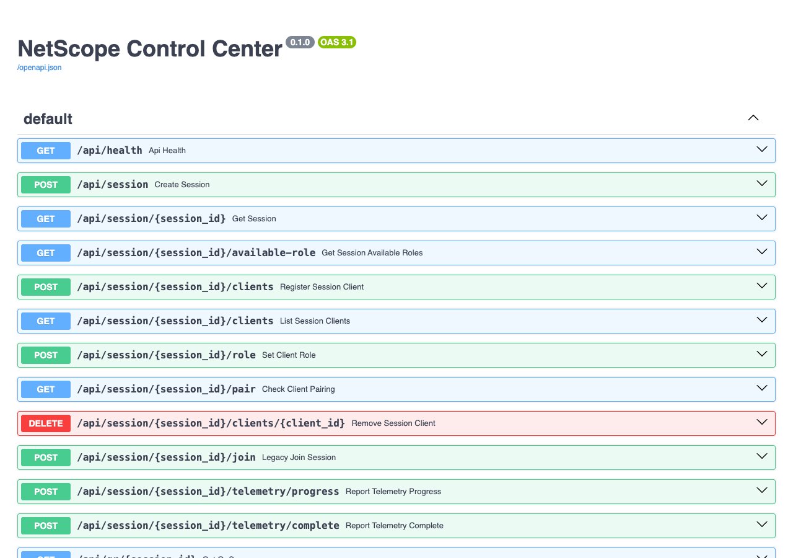
*Figure 6: Built-in Interactive OpenAPI / Swagger UI documentation at `http://localhost:8000/docs`.*

---

## 3. System Architecture & Data Plane

NetScope separates the **Control Plane** (HTTP/WebSocket session discovery, pairing, and metrics collection) from the **Data Plane** (raw TCP binary streaming on dedicated ports).

### Control Plane vs. Data Plane

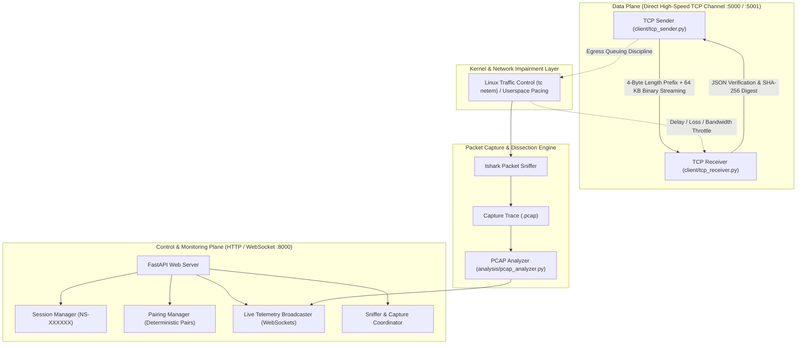

### Two-Machine Network Architecture

NetScope is engineered to operate across two physical Ubuntu machines over Ethernet/Wi-Fi or within a single machine using Linux Network Namespaces (`veth-c` <-> `veth-s`).

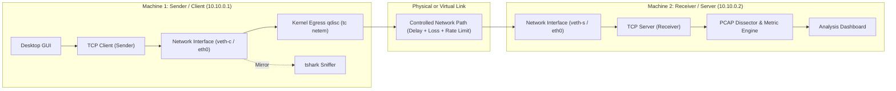

---

## 4. Mermaid System & Protocol Diagrams

### End-to-End System Workflow

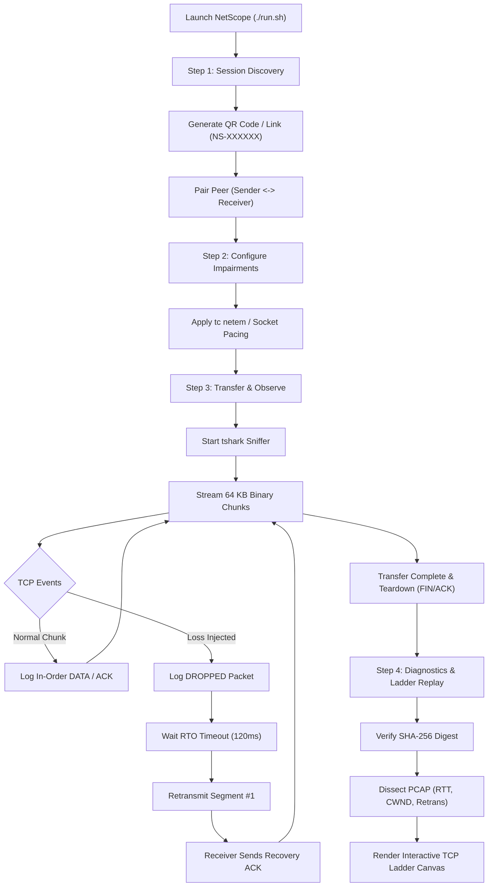

### Session & Pairing State Machine

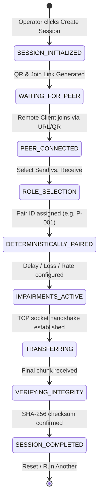

### TCP Handshake, Impairment Drop, RTO Timeout & Retransmission Sequence

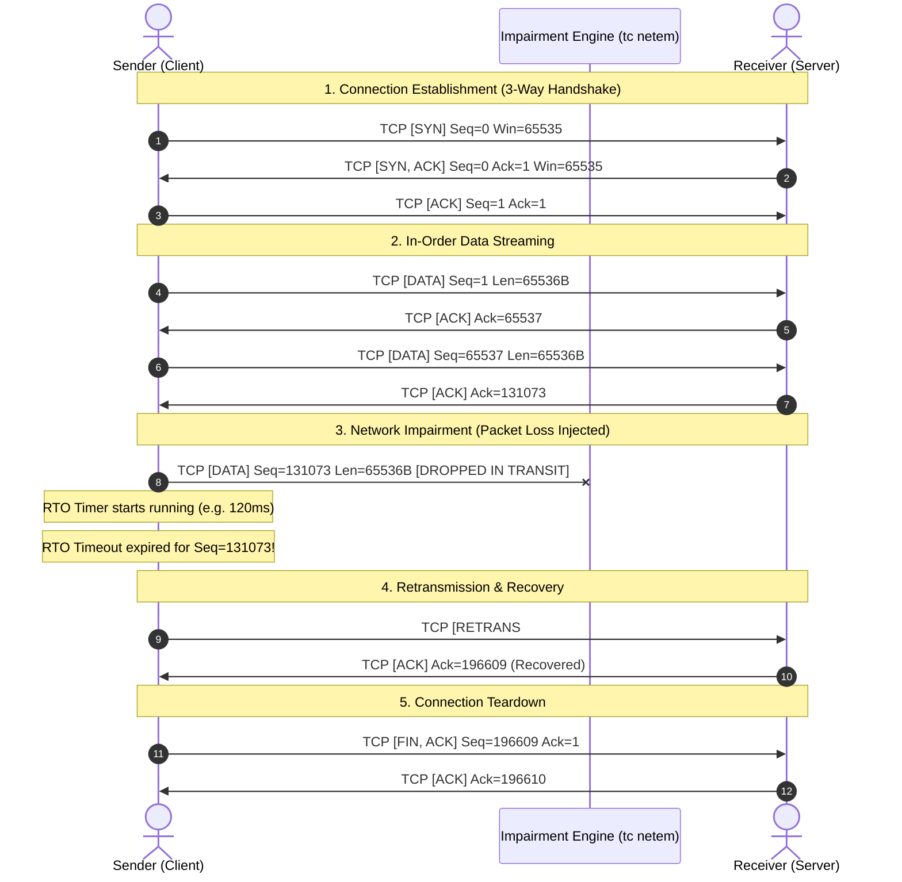

---

## 5. Network Impairment Engine

### Linux Kernel `tc netem` vs. Cross-Platform Simulation

NetScope supports two impairment execution modes:
1. **Linux Kernel Mode (`tc netem`):** Utilizes Linux Traffic Control with Network Namespaces (`veth-c` / `veth-s`). Applies true kernel-level queuing disciplines on egress.
2. **Cross-Platform / macOS Standalone Simulation:** When running on macOS Darwin or unprivileged Linux, NetScope emulates rate-limiting using high-precision chunk slicing and time-pacing (`time.perf_counter()`), coupled with probabilistic Bernoulli loss drops, exponential backoff RTO timers, and Reno congestion window tracking.

#### Why Impair on Egress and Capture on the Sender?
- **Delay Schedulers ($D$ ms):** `tc netem` operates exclusively on **egress** queues. In a one-way delay configuration of $D$ ms, the outgoing data packet is held for $D$ ms while the returning acknowledgment is unimpaired ($\approx RTT_0$). The measured Round Trip Time is:
  $$\text{Expected } RTT \approx RTT_0 + D$$
- **Retransmission Visibility:** Retransmissions originate at the sender when RTO timers expire or 3 duplicate ACKs are received. The receiver never observes lost packets—it only sees delays or holes. Therefore, Wireshark and `tshark` capture **must run on the sender** to record `tcp.analysis.retransmission`.

### Benchmark Scenarios

NetScope defines 11 standardized benchmark scenarios tested across file transfers:

| Scenario | Injected Delay ($D$) | Packet Loss ($L$) | Bandwidth Limit ($R$) | Primary TCP Behavior |
|:---|:---:|:---:|:---:|:---|
| **Baseline** | 0 ms | 0% | Unlimited | Max wire throughput, zero retransmissions |
| **Delay-1** | 50 ms | 0% | Unlimited | RTT inflates to ~52 ms; delayed ACK pacing |
| **Delay-2** | 100 ms | 0% | Unlimited | RTT inflates to ~102 ms; throughput bounded by BDP |
| **Delay-3** | 200 ms | 0% | Unlimited | High RTT; slow initial window expansion |
| **Loss-1** | 0 ms | 1% | Unlimited | Occasional Fast Retransmit; CWND halved |
| **Loss-2** | 0 ms | 2% | Unlimited | Frequent retransmissions; CWND oscillations |
| **Loss-3** | 0 ms | 5% | Unlimited | Severe throughput degradation; multiple RTO timeouts |
| **Bandwidth-1**| 0 ms | 0% | 10 Mbps | Sender paced at ~1.25 MB/s |
| **Bandwidth-2**| 0 ms | 0% | 5 Mbps | Sender paced at ~625 KB/s |
| **Bandwidth-3**| 0 ms | 0% | 1 Mbps | High transmission delay; queue buffering |
| **Combined** | 100 ms | 2% | 5 Mbps | Compounded degradation (low throughput + high RTT + drops) |

---

## 6. Packet Dissection & Wireshark / tshark Pipeline

NetScope automates live packet sniffing via `capture/sniffer.py` and trace extraction via `analysis/pcap_analyzer.py`.

### Automated Capture
When a transfer begins, `sniffer.py` executes:
```bash
tshark -i <interface> -f "tcp port 5000" -w results/pcaps/<run_id>.pcap
```
Upon transfer completion, a graceful `SIGINT` flushes all trailing packet trailers and saves the standard `.pcap` trace file.

### Protocol Dissection
`pcap_analyzer.py` invokes `tshark` field extraction to parse the trace without heavyweight external dependencies:
```bash
tshark -r <pcap_file> -T fields \
  -e frame.number -e frame.time_relative -e ip.src -e ip.dst \
  -e tcp.srcport -e tcp.dstport -e tcp.flags -e tcp.seq -e tcp.ack \
  -e tcp.len -e tcp.analysis.retransmission -e tcp.analysis.duplicate_ack \
  -e tcp.analysis.ack_rtt -e tcp.window_size
```

### Extracted Metrics
- **Handshake Duration (`handshake_ms`):** Time elapsed between initial `SYN` and third `ACK`.
- **Smoothed RTT (`rtt_avg_ms`, `rtt_min_ms`, `rtt_max_ms`):** Calculated from TCP ACK timestamps.
- **Retransmissions:** Count of retransmitted segments matching `tcp.analysis.retransmission`.
- **Integrity Validation:** SHA-256 match comparison between source file and received payload.

---

## 7. Quick Start & Setup Guide

NetScope supports **macOS (Darwin)**, **Ubuntu/Debian**, **Fedora/RHEL**, **Arch Linux**, and **WSL2**.

### Prerequisites
- Python 3.9 or higher
- Node.js 18 or higher and npm
- Optional: `wireshark` / `tshark` for live PCAP dissection

### 1. Automated One-Step Installation
Run the portable setup script from the root directory:
```bash
chmod +x setup.sh
./setup.sh
```

What `setup.sh` does automatically:
1. Detects OS and installs system tools (`iproute2`, `tshark`, `iperf3`).
2. Configures a clean Python virtual environment (`.venv`) and installs `requirements.txt`.
3. Installs Desktop UI (`frontend/desktop`) and Mobile UI (`frontend/mobile`) dependencies via npm.
4. Generates deterministic binary test payloads (`1 MB`, `5 MB`, `10 MB`).
5. Sets up Linux network namespaces (`ns-client`, `ns-server`) or activates standalone loopback mode.

### 2. Launching NetScope
Start the entire multi-process stack with a single command:
```bash
./run.sh
```

#### Services Started:
| Service | URL / Port | Purpose |
|---|---|---|
| **Desktop UI** | `http://localhost:5173` | Diagnostic dashboard, observer, and TCP ladder |
| **Mobile Join UI** | `http://localhost:5174` | Mobile peer participation interface |
| **FastAPI Backend** | `http://localhost:8000` | REST API, WebSockets, and session orchestration |
| **TCP Data Port** | Port `5000` (Linux) / `5001` (macOS) | Direct high-speed framed binary data stream |

### 3. Running Automated Tests
Validate system integrity with the automated test suite:
```bash
.venv/bin/python -m unittest discover tests
```

---

## 8. REST API & WebSocket Specifications

### Session & Discovery Endpoints
- `POST /api/session/create` — Initialize a new session and generate session code (`NS-XXXXXX`).
- `GET /api/session/{session_id}` — Query active session state and connected peers.
- `GET /api/qr/{session_id}` — Generate dynamic SVG QR code for mobile joining.
- `POST /api/session/{session_id}/register` — Register a peer device with role (`SEND` or `RECEIVE`).

### Impairment & Transfer Endpoints
- `POST /api/impair` — Apply kernel or simulated network impairment parameters (`delay`, `loss`, `rate`).
- `POST /api/transfer/start` — Initiate a file transfer run under configured parameters.
- `GET /api/transfer/status` — Get live transfer percentage, throughput (Mbps), and state.
- `GET /api/packets` — Query currently dissected packets for the active run.
- `GET /api/results` — Retrieve historical transfer records and metrics from `results/transfers.jsonl`.
- `GET /api/download/{run_id}` — Download the received binary file for integrity inspection.

### Real-Time WebSocket Channel
- `WebSocket /api/events` — High-frequency duplex event stream broadcasting:
  - `transfer_progress` — Current bytes, percentage, instant Mbps.
  - `telemetry_update` — Kernel RTT, CWND window size, retransmission count.
  - `packets_batch` — Dissected packet objects for the live ladder canvas.
  - `packet_event` — Discrete events (`SYN`, `DROPPED`, `TIMEOUT`, `RETRANS`, `FIN`).

---

## 9. Academic & Viva Reference

### Course Outcome (CO1) Mapping
- **Internet Protocol Stack:** Practical inspection of Layer 4 (TCP) transport mechanisms over Layer 3 (IP).
- **Socket Programming:** Implementation of framed streaming, non-blocking polling, and socket options.
- **Protocol Analysis:** Hands-on trace analysis using `tshark` filters and sequence number math.
- **Debugging Distributed Applications:** Diagnosing timeout expirations, packet loss anomalies, and rate throttling.

### Key Concepts for Viva / Technical Discussion
1. **Why does throughput drop non-linearly with packet loss?**
   Under TCP Reno/Cubic, any detected packet loss forces the Congestion Window (`CWND`) to halve (Multiplicative Decrease). When loss exceeds 2–5%, frequent RTO expirations force `CWND` back to 1 MSS, collapsing throughput.
2. **Why does Bandwidth-Delay Product (BDP) matter?**
   $$\text{BDP} = \text{Bandwidth} \times \text{RTT}$$
   To maximize wire speed, the TCP socket buffer and window size must be at least equal to the BDP. If RTT is high (e.g. 200 ms) and window size is constrained, throughput is bottlenecked by window stalling.
3. **Difference between Fast Retransmit and RTO Timeout:**
   - **Fast Retransmit:** Triggered when the sender receives **3 Duplicate ACKs** for the same sequence number, signaling an isolated dropped packet while other packets continue arriving.
   - **RTO Timeout:** Triggered when the retransmission timer expires without any incoming ACKs, signaling severe congestion or total link loss. The sender throttles `CWND` to 1 MSS and retransmits.

---

### Project Work Distribution (3 Team Members)

```text
├── Member 1: Application Architecture & Session Management
│   └── TCP Sender/Receiver, Session Manager, QR/Link Discovery, Framing Protocol, Cryptographic Verification
├── Member 2: Network Impairment & Linux Kernel Emulation
│   └── Linux tc/netem qdisc scripts, Network Namespaces (veth), Delay/Loss/Rate profiling, Benchmark Runner
└── Member 3: Packet Analysis, PCAP Dissection & UI Dashboard
    └── tshark Capture Pipeline, PCAP Analyzer, HTML5 Canvas TCP Ladder, Real-time Charts, KPI Metrics
```

---

*Developed for Advanced Computer Networks & Distributed Systems Laboratory.*
